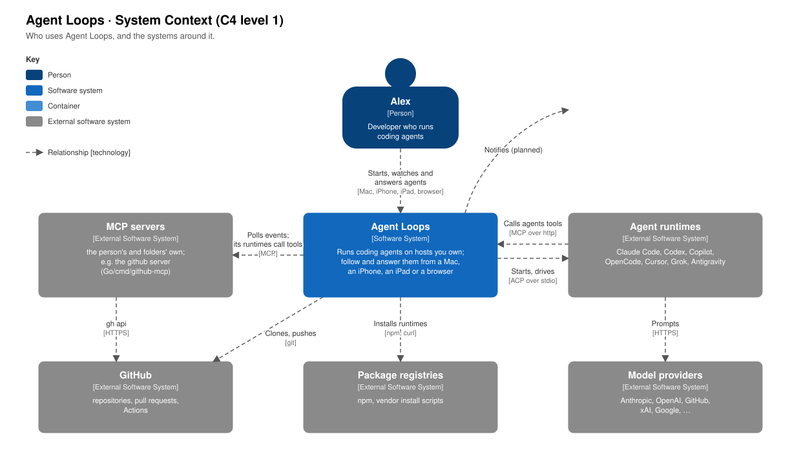
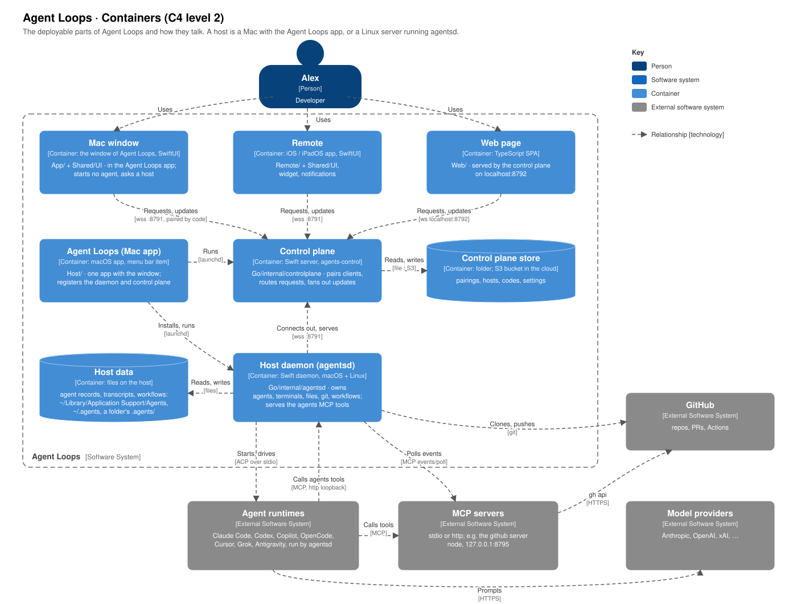
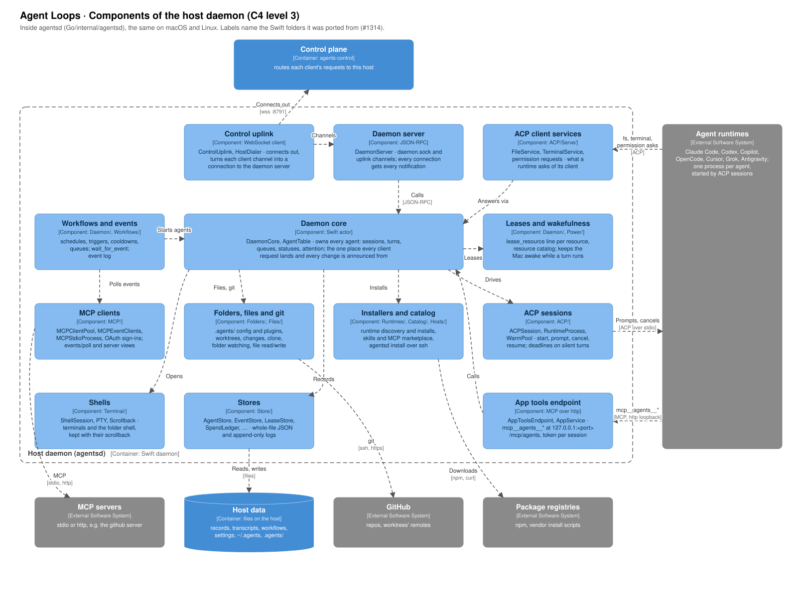
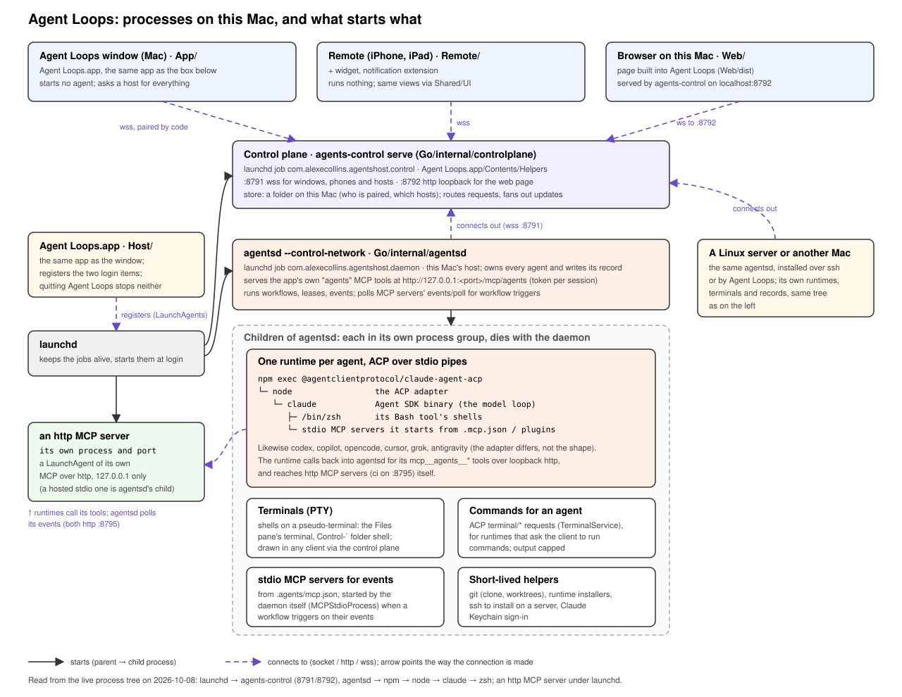
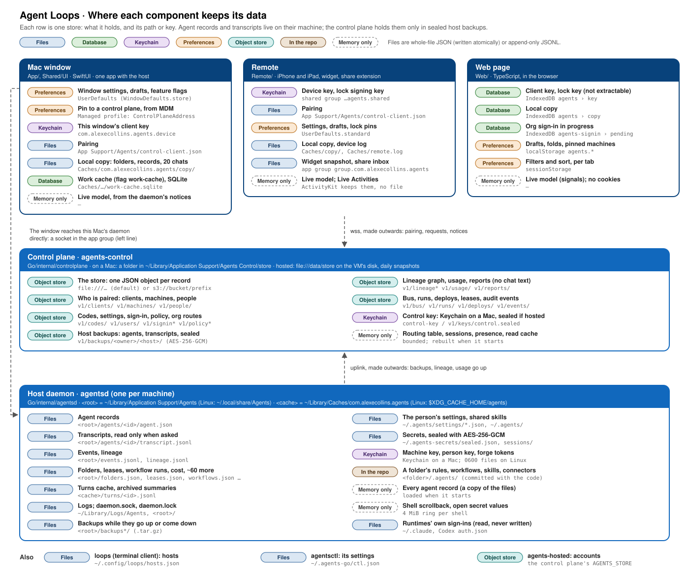

# Architecture

A wireframe first, then four views of Agent Loops, from the outside in, in the style of the
[C4 model](https://c4model.com): the system and its neighbours, the containers it is made
of, the components inside the host daemon, and how they run as processes on a Mac. A last
view shows where each component keeps its data.

## At a glance

Read the wireframe from the top (what you see) to the bottom (what does the work). The
numbers are the blue pins.

- **1 · Screens show; they run nothing.** The Mac window, the Remote on iPhone and iPad, and
   the web page draw the same product. Windows and Android come soon. Each one asks a
   machine for everything and passes on what you type and click.
- **2 · The control plane is the switchboard.** It pairs each screen and each machine, and
   sends each request to the machine it is for. It runs in the cloud: at agentloops.dev for
   a hosted account, or on your own hosting. A Mac can run one for its one person, as an
   option. Its store is a folder or a bucket. It holds who is paired and which machines
   there are, and figures such as usage, but no agent's chat, except inside a sealed
   backup of a machine. There is no relay: no Mac passes traffic for
   other screens or machines.
- **3 · Everything connects out.** Screens and machines all dial the control plane. A machine
   never has to be reachable, so a server behind a firewall works. The one shortcut: the
   window on a Mac goes direct to that same Mac.
- **4 · The host daemon does the work.** `agentsd` owns the agents on its machine. "Agents
   and turns" is its heart: every change to an agent is announced from there, so every
   screen agrees. The other parts talk, do the work around an agent, and remember it on
   disk.
- **5 · The agents are other people's runtimes.** Agent Loops starts Claude Code, Codex and the
   others, and drives them over ACP. They prompt their own model, and call back into
   Agent Loops for its own tools.
- **6 · Work and Docs are what the agents work from.** Work is the issues, pull requests and
   epics on every forge, in one list. Docs is the specs and docs, from a folder or from
   Confluence, Notion or Drive. Lineage links each session to the issue, the doc and the
   pull request it works on.

## System context

You use Agent Loops to run coding agents on hosts you own, and follow and answer them from a
Mac, an iPhone, an iPad or a browser. Agent Loops does not talk to a model itself. It starts and
drives an **agent runtime** (Claude Code, Codex, Copilot, OpenCode, Cursor or Grok)
over ACP, and the runtime prompts its own provider. A runtime calls back into Agent Loops for the
app's own tools (`mcp__agents__*`) over MCP.

Agent Loops also polls **MCP servers** for the events that trigger workflows, clones and pushes
to **GitHub** with git, and installs runtimes from **package registries**. The control
plane sends notifications to phones itself, through **APNs**.

## Containers

| Container | Code | Technology | What it does |
| --- | --- | --- | --- |
| Mac window | `App/`, `Shared/UI` | The window of the macOS app Agent Loops, SwiftUI | A client. Starts no agent; asks a host for everything. |
| Remote | `Remote/`, `Shared/UI` | iOS and iPadOS app, SwiftUI, with a widget | A client, on the phone and the iPad. |
| Web page | `Web/` | TypeScript single-page app | A client, served by the control plane on `localhost:8792`. |
| Agent Loops (the Mac app) | `Host/`, `App/` | macOS app with a menu bar item, a Developer ID download | Carries the daemon and the control plane, registers them with launchd, and pairs its own window. One app with the Mac window. |
| Control plane | `Go/cmd/agents-control`, `Go/internal/controlplane` | Go server, `agents-control` | Pairs clients, routes each request to its host, sends updates to clients. `:8791` wss, `:8792` loopback http. |
| Control plane store | `Go/internal/controlplane/store` | A folder (on a Mac, always a folder on that Mac), or an S3 bucket in the cloud | Who is paired, which hosts there are, codes, settings, sign-in and policy; lineage, usage and reports; sealed host backups. No transcript in clear. |
| Host daemon | `Go/cmd/agentsd`, `Go/internal/agentsd` | Go daemon, `agentsd`, macOS and Linux | Owns agents, terminals, files, git and workflows on its host. Serves the agents MCP tools. |
| Host data | | Files on the host, and the Keychain on a Mac | Agent records and transcripts in `~/Library/Application Support/Agents` (Linux: `~/.local/share/Agents`); the person's settings in `~/.agents/settings`, and shared skills and instructions in `~/.agents` ([the `~/.agents` folder](../reference/agents-folder.md)); sealed secrets in `~/.agents-secrets`; a folder's own `.agents/`. See [Where the data is kept](#where-the-data-is-kept). |

Every connection to the control plane is made **outwards**: from a client, and from each
host. A client never reaches a host directly, and a host never needs to be reachable. A
Linux server or another Mac is one more host daemon with its own host data, connected the
same way. See [The control plane](control-plane.md).

## Components of the host daemon

`agentsd` is the same program on macOS and Linux, in Go (#1134; the Swift one went in
#1314). Its code is in `Go/cmd/agentsd` and `Go/internal/agentsd`; the files below are under
`Go/internal/agentsd`. On a Mac it asks two small Swift helpers beside it for what Go cannot
reach without cgo: `agents-peer` (callers' code signatures) and `agents-watch` (FSEvents).

| Component | Code | What it does |
| --- | --- | --- |
| Control uplink | `Go/internal/controllink`, `daemon.go` | The host's one connection out to the control plane. Each client's channel on it becomes a connection to the daemon server. |
| Daemon server | `rpc.go`, `methods.go` | JSON-RPC, over `daemon.sock` and over the uplink's channels. Every connection gets every notification, so clients agree. |
| Agents and turns | `agents.go`, `turns.go`, `sessions.go`, `attention.go` | Owns every agent: sessions, turns, queues, statuses and attention. Every change is announced from here. |
| Workflows and events | `workflows.go`, `workflowruns.go`, `events.go`, `eventwaits.go` | Schedules, triggers, cooldowns and queues. `wait_for_event` and the event log. |
| Leases and wakefulness | `leases.go`, `leasecalls.go`, `wake.go` | A line per declared resource. Keeps the Mac awake while a turn runs. |
| MCP clients | `mcpclient.go`, `mcpevents.go`, `mcpsignin.go`, `viewservers.go` | The daemon's own connections to MCP servers: `events/poll` for workflow triggers, server views and OAuth sign-ins. |
| Folders, files and git | `folders.go`, `files.go`, `git.go`, `worktrees.go`, `changes.go` | `.agents/` config and plugins, worktrees, changes, clones, folder watching, and file reads and writes for clients. |
| Installers and catalog | `install.go`, `runtimes.go`, `mcpcatalog/`, `skillcatalog/` | Finds and installs runtimes, and installs skills and MCP servers from the marketplace. |
| ACP sessions | `acp/` | Starts each runtime, and prompts, cancels and resumes it over ACP. |
| App tools endpoint | `apptools.go`, `agenttools.go` | The `mcp__agents__*` tools, over loopback http with a token per session. |
| Shells | `shells.go` | Terminals and the folder shell, each a pseudo-terminal with its scrollback. |
| Stores | `store/`, `diskjson/` | Whole-file JSON and append-only logs in the host data, in the layout the Swift host kept. |

## Processes on this Mac

This is how the containers above run on a Mac. A solid arrow means one program starts
another. A dashed arrow is a connection, pointing the way it is made.

**Agent Loops** registers two login items, and launchd runs them whether the app is open or
not. Quitting Agent Loops stops neither:

| launchd job | Program |
| --- | --- |
| `com.alexecollins.agentshost.daemon` | `agentsd --control-network` |
| `com.alexecollins.agentshost.control` | `agents-control serve --port 8791` |

The clients start no processes. Every process to do with an agent is a child of `agentsd`,
in a process group of its own, so stopping an agent, or the daemon, takes its whole group
with it:

- **A runtime per agent**, speaking ACP over stdio. For Claude:
  `npm exec @agentclientprotocol/claude-agent-acp` → `node` (the ACP adapter) → `claude`
  (the Agent SDK binary). The runtime starts its own children: shells for its Bash tool,
  and the stdio MCP servers in `.mcp.json` and plugins.
- **Terminals**: shells on a pseudo-terminal, such as the Files pane's terminal and the
  Control-` folder shell.
- **Commands for an agent**: what a runtime asks its client to run over ACP's `terminal/*`.
- **MCP servers for events**: stdio servers in `.agents/mcp.json` that a workflow triggers
  on, polled by the daemon.
- **Short-lived helpers**: git, runtime installers, ssh to install on a server, the Claude
  Keychain sign-in.

The agents MCP tools are not a process. The daemon serves them at
`http://127.0.0.1:<port>/mcp/agents`, with a token for each session (#185). An http MCP
server belongs to no one in this tree: it is a LaunchAgent of its own. A hosted stdio one,
such as the github server (`github-mcp`), is a child of agentsd.

## Where the data is kept

Each component keeps its own data. Read the diagram from the top (the clients) to the
bottom (the host daemon). The colour of each label gives the medium.

- **The host daemon keeps the agents.** Each agent's record is a whole-file JSON
  `agent.json`, and its transcript is an append-only `transcript.jsonl`, under the root
  folder (`~/Library/Application Support/Agents` on a Mac, `~/.local/share/Agents` on
  Linux). The daemon keeps every record in memory too, but it reads a transcript from
  disk only when a client asks for it. About 60 more JSON files in the root hold folders,
  leases, workflow runs, events, lineage and cost. The daemon writes each whole file
  atomically. It uses no database.
- **Secrets and keys are sealed or in the Keychain.** Secrets are in
  `~/.agents-secrets/sealed.json`, sealed with AES-256-GCM. The machine key, the person
  key and the forge tokens are in the Keychain on a Mac, and in files only the person can
  read (`0600`) on Linux.
- **A folder's rules go with its code.** `.agents/` in each folder (rules, workflows,
  skills and connectors) is in git.
- **The control plane keeps one JSON object per record** in its store: a folder, or an S3
  bucket in the cloud. It keeps who is paired, codes, settings, sign-in, policy, lineage,
  usage and reports. A machine's backup goes there too, sealed. Its routing table,
  sessions and read cache are in memory only, and it makes them again when it starts.
- **Clients keep a copy, a key and preferences.** Each client keeps a local copy of what
  it showed last, so a page draws at once, also when its machine does not answer. The Mac
  window and the Remote keep the copy in their Caches folder, and their client key in the
  Keychain. The web page keeps both in IndexedDB, and the key cannot be read out of the
  browser. Work's cache is a SQLite file on the Mac window and the Remote, and IndexedDB on the web page.
  Preferences and drafts are in UserDefaults on the Mac and the Remote, and in
  `localStorage` on the web page.

| Component | Medium | What | Where |
| --- | --- | --- | --- |
| Host daemon | Files | Agent records, transcripts, events, lineage, folders, leases, workflow runs, cost | `<root>/agents/<id>/agent.json`, `transcript.jsonl`, `<root>/*.json`, `*.jsonl` |
| Host daemon | Files | Turns cache, archived summaries | `~/Library/Caches/com.alexecollins.agents` (Linux: `$XDG_CACHE_HOME/agents`) |
| Host daemon | Files | The person's settings; shared skills and instructions | `~/.agents/settings/*.json`, `~/.agents/` |
| Host daemon | Files, sealed | Secrets | `~/.agents-secrets/sealed.json`, `sessions/` |
| Host daemon | Keychain (Linux: `0600` files) | Machine key, person key, forge tokens | `agents.machine-key.*`, `agents.person-key.*`, `agents.connection.*` |
| Host daemon | Git | A folder's rules, workflows, skills, connectors | `<folder>/.agents/` |
| Host daemon | Memory | Every agent record (a copy of its file), shell scrollback (4 MiB a shell), open secret values | |
| Control plane | Folder or S3 bucket | Clients, machines, people, codes, settings, sign-in, policy, lineage, usage, reports, runs, deploys, leases, audit events, sealed host backups | `v1/…` in `--store` (`file:///…` or `s3://bucket/prefix`) |
| Control plane | Keychain (hosted: the store, sealed) | The control key | `control-key`, `v1/keys/control.sealed` |
| Control plane | Memory | Routing table, sessions, presence, read cache | |
| Mac window | UserDefaults, Keychain | Preferences, drafts, flags, a pin from MDM; the client key | `WindowDefaults.store`; `com.alexecollins.agents.device` |
| Mac window | Files, SQLite | Pairing; local copy; Work cache | `control-client.json`; `Caches/…/copy/`; `Caches/…/work-cache.sqlite` |
| Remote | Keychain, UserDefaults | Device key, lock signing key; preferences, drafts, lock pins | shared group `…agents.shared`; `UserDefaults.standard` |
| Remote | Files | Pairing; local copy and device log; widget snapshot and share inbox | `control-client.json`; `Caches/`; the app group |
| Web page | IndexedDB | Client key and lock key; local copy; Work cache; an org sign-in in progress | `agents` › `key`, `copy`, `work`; `agents-signin` |
| Web page | `localStorage`, `sessionStorage` | Drafts, folds, pinned machines; filters and sort for each tab | `agents.*` |

The runtimes keep their own data, such as `~/.claude`. The daemon reads their sign-ins
and never writes them.

No store may grow without bound. [How data stores stay bounded](data-stores.md) says the
rules each store follows.

## Related

- [The window and the host](window-and-daemon.md).
- [The control plane](control-plane.md).
- [How the phone and iPad reach your agents](phone-and-ipad.md).
