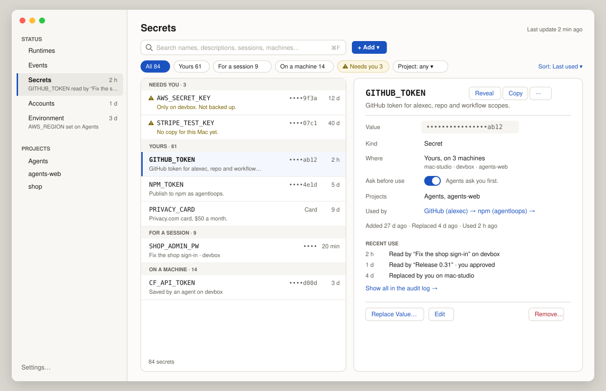
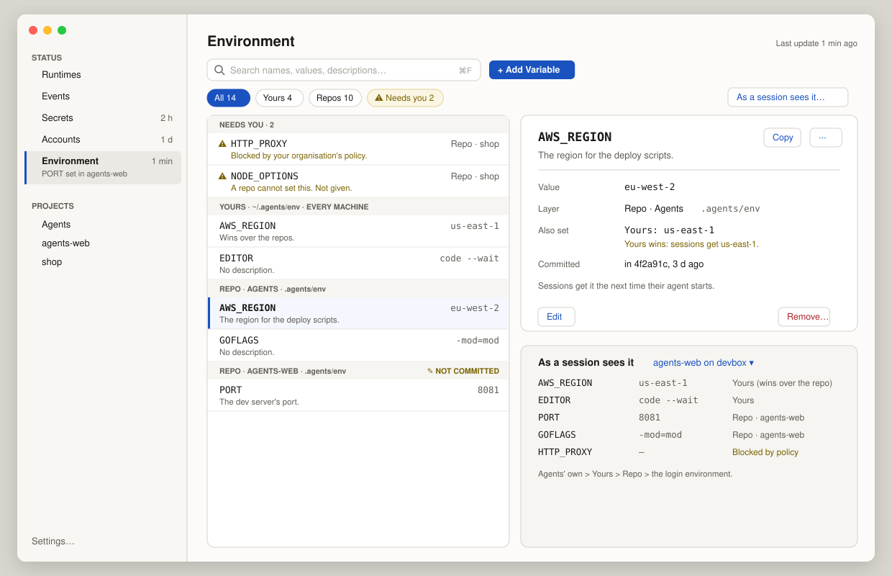
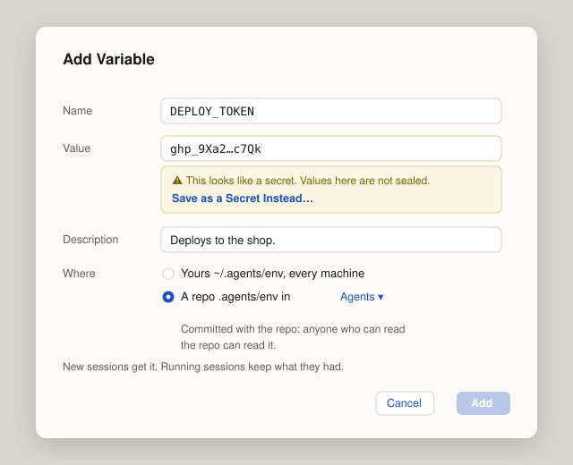

# Wireframes: secrets, accounts and environment variables in one place

Alex, 2026-11-13: "I don't like the secrets and accounts experience (and I think we need a new
Environment Variables / Environ experience). We currently split experiences into status and settings
and only show some brief detail for status. Only create and edit in settings. We also don't make it
easy to find one account/secret amongst many. Start with some wireframes."

Epic #5254. All names, values, machines and projects below are made-up examples. The hi-fi pictures come first, then the lo-fi sections with the rules.

## Hi-fi (Mac)

Drawn in the paper tokens (`design/tokens.json`): ground, raised, well, rule, the cobalt accent, the
attention tint and the vouched green. Made-up data. The lo-fi sections below give the rules, and the
web page, the Remote and Accounts.

**Secrets, opened from Status ▸ Secrets:** the chips, the Needs you group on top, a secret selected,
and its detail with Reveal, Copy, the Ask before use switch, Used by and Recent use. Section 2.



**Environment, opened from Status ▸ Environment:** your `~/.agents/env` and each repo's `.agents/env`,
a policy-blocked name and a refused name in Needs you, a repo variable that yours overrides, and As a
session sees it. Section 4.



**Add Variable, with a value that looks like a secret:** refused, with Save as a Secret Instead. Section 4b.



## The problems

| Today | Why it is bad |
|---|---|
| Status ▸ Secrets and Status ▸ Accounts (#4161) only show a list and a brief line. | You see the item but you cannot do anything with it. A press sends you to Settings. |
| Settings ▸ You ▸ Secrets and ▸ Accounts are the only places to add, edit, reveal and copy. | Two places for one thing. Settings is for how the app works, not for your data. |
| Secrets is three long sections (yours, For One Session, On This Machine). | To find one secret among 80, you scroll and read. No search, no filter, no sort. |
| Accounts has a Project picker only. | You cannot find an account by its service, address or the secret it uses. |
| No environment variables. | A person cannot give their agents `AWS_REGION` or `NODE_ENV` by project, folder or machine. |

## The proposal in one line

**One page for each, opened from the sidebar, where you find, see, add, edit and remove.** Status
keeps its brief rows in the sidebar; they open the page, not a read-only list. Settings ▸ You loses
Secrets and Accounts (a link stays there for people who look in Settings).

---

## 1. The sidebar: Status rows open the page (Mac)

The rows stay as they are (#4161, #4931), with a third row for Environment. A press opens the page
in the main area, where a session's chat goes.

```
┌ Sidebar ─────────────────────────┐
│ STATUS                           │
│  ⚙ Runtimes                      │
│  ⚡ Events                        │
│  🔑 Secrets               2 h    │  ← the newest operation's age (#4161)
│     GITHUB_TOKEN read by "Fix…"  │  ← under 4 h old only (#4931)
│  👤 Accounts              1 d    │
│  ⌥ Environment            3 d    │  ← new
│     AWS_REGION set on agents-web │
│                                  │
│ PROJECTS                         │
│  …                               │
└──────────────────────────────────┘
```

Settings ▸ You keeps one line where Secrets and Accounts were:

```
┌ Settings ▸ You ──────────────────────────────────────────────────────┐
│  Secrets, accounts and environment variables are in the sidebar,     │
│  under Status.                     [Open Secrets] [Open Accounts]    │
└──────────────────────────────────────────────────────────────────────┘
```

Options for where the page lives (recommended first):

- **A. One page per row, opened from Status (recommended).** Three rows, one shared layout. Fewer
  clicks, and the brief line and the full page are one thing.
- B. Keep the pages in Settings; Status rows open Settings at that item. Less work, but Settings
  stays the place for your data, and Status stays read-only.
- C. One page, **Keys**, with three tabs (Secrets | Accounts | Environment) and one Status row. One
  search across all three, but a tab bar on top of a list on top of a detail is a deep stack.

---

## 2. The page: a list you can search, and the detail beside it (Mac and web)

Mac window and web page, wide: the list on the left, the selected item on the right. The same frame
for the three pages. The sample is Secrets.

```
┌ Secrets ───────────────────────────────────────────────────────────────────────────────────────┐
│ [🔍 Search names, descriptions, sessions…      ⌘F]  [+ Add ▾]               Last update 2 min ago│
│ (All 84) (Yours 61) (For a session 9) (On a machine 14)   (⚠ Needs you 3) (Project: any ▾) [↕ Last used ▾]│
├──────────────────────────────────────────┬─────────────────────────────────────────────────────┤
│ NEEDS YOU                                │  GITHUB_TOKEN                          (👁) (⧉) (⋯) │
│ ⚠ AWS_SECRET_KEY        ••••9f3a   12 d  │  GitHub token for alexec, repo and workflow scopes. │
│   Only on devbox. Not backed up.         │  ─────────────────────────────────────────────────  │
│ ⚠ STRIPE_TEST_KEY       ••••07c1   40 d  │  Value        ••••••••••••••••••••ab12              │
│   No copy for this browser yet.          │  Kind         Secret                                │
│ ─────────────────────────────────────────│  Where        Yours, on 3 machines                  │
│ YOURS                                    │               mac-studio · devbox · agents-web      │
│ ▶ GITHUB_TOKEN          ••••ab12    2 h  │  Ask before use  [● on ]  Agents ask you first.     │
│   GitHub token for alexec, repo and…     │  Projects     Agents, agents-web                    │
│   NPM_TOKEN             ••••4e1d    5 d  │  Used by      2 accounts: GitHub (alexec), npm      │
│   Publish to npm as agentloops.          │  Added 27 d ago · Replaced 4 d ago · Used 2 h ago   │
│   PRIVACY_CARD          Card        9 d  │                                                     │
│   Privacy.com card, $50 a month.         │  RECENT USE                                         │
│   …                                      │   2 h   read by "Fix the shop sign-in" on devbox    │
│ ─────────────────────────────────────────│   1 d   read by "Release 0.31"  · you approved      │
│ FOR A SESSION                            │   4 d   replaced by you on mac-studio               │
│   SHOP_ADMIN_PW         ••••   20 min    │   Show all in the audit log →                       │
│   Fix the shop sign-in · devbox          │                                                     │
│ ─────────────────────────────────────────│  [Replace Value…]   [Edit]          [Remove…]       │
│ ON A MACHINE                             │                                                     │
│   CF_API_TOKEN          ••••d00d    3 d  │                                                     │
│   Saved by an agent on devbox            │                                                     │
└──────────────────────────────────────────┴─────────────────────────────────────────────────────┘
```

Rules:

- **Search** matches the name, the description, the session title, the machine, the project and
  the service of an account that uses it. It never searches a value. Typing filters the list at
  once; the count in each chip goes down with it. `⌘F` puts the cursor in the field; `↑` `↓` move
  the selection; `Return` opens the detail; `Esc` clears the search.
- **Chips** filter by where the secret is (Yours, For a session, On a machine) and by **Needs you**:
  not backed up, no copy for this client yet, did not open, a token that expires in 30 days, not
  used in 90 days. **Project** is a menu. Chips and search add together (AND).
- **Sort**: Last used (the default), Name, Added. The **Needs you** group stays on top, whatever the
  sort, while it has items.
- **The list row** has two lines: the name, the last 4 (or **Card**), the age of the last use; under
  it the description in grey, or the warning for an item in Needs you.
- **The detail** shows everything about one item and is where you change it: Reveal (👁) and Copy
  (⧉) as in #5115 (Mac + web only), **Ask before use** as a switch you change here, **Edit** makes the
  description and projects fields you can type in, in place. **Replace Value…** and **Remove…** ask
  first, as today.
- **Used by** links to the accounts that name this secret (#3967), and each opens in Accounts.
- **Recent use** shows the last three operations from the audit log, with a link to all.
- Nothing selected: the right side says *Select a secret to see it.* and shows the counts.
- Search with no result: *No secret matches "stripe live".* and **[Clear Search]**.

**Narrow window or web page under 720 pt:** the list only; a press pushes the detail, with a back
arrow. (The same as the Remote, section 6.)

### 2a. Add (the `+ Add ▾` menu)

```
[+ Add ▾]  Add a Secret…
           Add a Card…
           Add for a Session…
```

Each opens today's sheet (#3531, #3548, #4016, #4167), with no change. When it is saved, the new
item is selected in the list and the detail shows it.

---

## 3. Accounts: the same frame

Today's **Details…** sheet (#5116) becomes the right side. **Edit** turns its fields into fields you
type in, in place; there is no separate Edit… sheet.

```
┌ Accounts ──────────────────────────────────────────────────────────────────────────────────────┐
│ [🔍 Search service, address, plan, secret…     ⌘F]  [+ Add Account]          Last update 1 min ago│
│ (All 23) (⚠ Needs you 2) (Asks before use 18)  (Project: any ▾)  (Service: any ▾) [↕ Service ▾]│
├──────────────────────────────────────────┬─────────────────────────────────────────────────────┤
│ NEEDS YOU                                │  GitHub · alexec                       (⋯)         │
│ ⚠ Cloudflare · agentloops@…   ••••d00d   │  Pushes, PRs and Actions for agentloops-dev.        │
│   Token expires in 6 d.                  │  ─────────────────────────────────────────────────  │
│ ─────────────────────────────────────────│  Service      GitHub                         (⧉)    │
│ ▶ GitHub · alexec             ••••ab12   │  Address      alex@example.com               (⧉)    │
│   Pushes, PRs and Actions for…   $4/mo   │  User name    alexec                         (⧉)    │
│   npm · agentloops            ••••4e1d   │  Plan         Team · $4 a month                     │
│   Publish to npm as…             free    │  Secret       GITHUB_TOKEN  ••••ab12  (👁) (⧉) →   │
│   Google Cloud · agentloops@  ••••77aa   │  Two-factor   TOTP (github-totp)                    │
│   Vertex AI for the Linux…      $12/mo   │  Projects     Agents, agents-web                    │
│   …                                      │  Ask before use  [● on ]                            │
│                                          │  Made 9 d ago · Edited 1 d ago · Used 2 h ago       │
│                                          │                                                     │
│ 23 accounts · $61 a month                │  [Edit]                              [Remove…]      │
└──────────────────────────────────────────┴─────────────────────────────────────────────────────┘
```

- **Search** matches service, address, user name, plan, description, project and the secret's name.
- **Service** is a menu of the services you have (GitHub, Google Cloud, npm…), for people with many
  accounts on one service.
- The secret's **→** opens it on the Secrets page.
- The total a month stays at the foot of the list, and changes with the filter ("4 of 23 · $16 a month").

---

## 4. Environment: the new page

Plain variables that agents' sessions get in their environment when they start. They are kept in
two plain files, as `AGENTS.md` and `mcp.json` are (Alex, 2026-11-13):

| Layer | File | Kept | Wins over |
|---|---|---|---|
| **Yours** | `~/.agents/env` | the person's settings, written to `~/.agents/env` on **every** machine of theirs | the repo |
| **Repo** | `<repo>/.agents/env` | in the repo, committed, read from the session's worktree | the login environment |

So the order is: Agents' own variables > **Yours** > **Repo** > the login environment. The format is
`NAME=value`, one a line; a `# comment` line just above a variable is its description:

```
# The region for the deploy scripts.
AWS_REGION=eu-west-2
GOFLAGS=-mod=mod
```

**Not like Secrets and Accounts (Alex, 2026-11-13).** Secrets and Accounts are never kept anywhere
public. Secrets are sealed to the person's machines and clients (#3397). Accounts are in the person's
settings on the control plane (#3967). Neither ever goes in a repo or in a file another person can read,
and neither gets a Repo layer. Environment variables are the opposite: plain configuration that a repo
may publish. That is why:

| | Secrets | Accounts | Environment |
|---|---|---|---|
| Kept | sealed, per machine and client | the person's settings, control plane | plain files: `~/.agents/env`, `<repo>/.agents/env` |
| Public? | never | never | the repo's file is as public as the repo |
| Agent gets the value | when it asks (`agents-secret`), with Ask before use | `manage_accounts get`, with Ask before use | in its environment at start, no asking |
| A value that looks like a secret | the place for it | refused (#3967) | refused, with Save as a Secret Instead |

The pages share a frame (search, chips, list and detail), not a store. The Environment page's
header says where the values live, so nobody takes it for a safe place:

```
│ Environment   Plain text in ~/.agents/env and each repo's .agents/env. Secrets go in Secrets. │
```

A secret-looking value found in a **repo's** file by hand is already public: its Needs you line says
*"This is in the repo, so it is public. Revoke it, then add it to Secrets."*, not only "move it".

### 4a. The list

The list shows your file (the same on every machine), then each repo's file, grouped.

```
┌ Environment ───────────────────────────────────────────────────────────────────────────────────┐
│ [🔍 Search names, values, descriptions…        ⌘F]  [+ Add Variable]         Last update 1 min ago │
│ (All 14) (Yours 4) (Repos 10) (⚠ Needs you 2)                          [As a session sees it…]  │
├──────────────────────────────────────────┬─────────────────────────────────────────────────────┤
│ NEEDS YOU                                │  AWS_REGION                              (⧉) (⋯)   │
│ ⚠ HTTP_PROXY        Repo · shop          │  The region for the deploy scripts.                 │
│   Blocked by your organisation's policy. │  ─────────────────────────────────────────────────  │
│ ⚠ NODE_OPTIONS      Repo · shop          │  Value      eu-west-2                                │
│   A repo cannot set this. Not given.     │  Layer      Repo · Agents  (.agents/env)            │
│ ─────────────────────────────────────────│  Also set   Yours: us-east-1                        │
│ YOURS · ~/.agents/env, every machine     │             Yours wins: sessions get us-east-1      │
│   AWS_REGION             us-east-1       │  Committed  in 4f2a91c, 3 d ago                     │
│   EDITOR                 code --wait     │  Sessions get it the next time their agent starts.  │
│ REPO · Agents  .agents/env               │                                                     │
│ ▶ AWS_REGION             eu-west-2       │  [Edit]                              [Remove…]      │
│   GOFLAGS                -mod=mod        │                                                     │
│ REPO · agents-web  .agents/env  ✎ not committed                                               │
│   PORT                   8081            │                                                     │
└──────────────────────────────────────────┴─────────────────────────────────────────────────────┘
```

- An edit to a repo's file writes it in the folder on that machine and leaves it **not committed**;
  the group says so. The person (or an agent) commits it as any other change.
- The repo's file is read from the session's worktree, so a branch can change it.

### 4b. Add Variable

```
┌ Add Variable ──────────────────────────────────────────────┐
│  Name          [AWS_REGION                    ]            │
│  Value         [eu-west-2                     ]            │
│  Description   [The region for the deploy scripts.]        │
│  Where         (•) Yours   ~/.agents/env, every machine    │
│                ( ) A repo  .agents/env in   [Agents     ▾] │
│                    Committed with the repo: anyone who     │
│                    can read the repo can read it.          │
│                                                            │
│  Sessions get it the next time their agent starts.        │
│                                       [Cancel]  [Add]      │
└────────────────────────────────────────────────────────────┘
```

When the value or the name looks like a secret (the daemon's `secretLooking` rule, and a value that
looks like a token), Add is refused with:

```
│  ⚠ This looks like a secret. Values here are not sealed.   │
│                         [Save as a Secret Instead…]        │
```

A file edited by hand can still hold one: the row goes in Needs you and the variable is still given,
because refusing it would not take it out of the file. In `~/.agents/env` the line says *"This looks
like a secret. Move it to Secrets."*; in a repo's file it says *"This is in the repo, so it is public.
Revoke it, then add it to Secrets."*

### 4c. As a session sees it

The button on the list opens a picker (a folder on a machine, or a running session). The list then
shows the result, one row per name, and the layer that wins:

```
┌ As a session sees it: agents-web on devbox ────────────────────────[Done]┐
│  AWS_REGION   us-east-1       Yours            (wins over the repo)      │
│  EDITOR       code --wait     Yours                                      │
│  PORT         8081            Repo agents-web                            │
│  NODE_OPTIONS —               A repo cannot set this                     │
│  HTTP_PROXY   —               Blocked by policy                          │
└──────────────────────────────────────────────────────────────────────────┘
```

A name that the organisation's policy does not allow (the existing environment-variables list
rule, `policylayers`) is kept but not given, and goes in Needs you.

**How a session gets them (#5259):** agentsd reads both files when it starts the agent's process and
sets them on it, after the login environment and before Agents' own variables (so Agents' own always
win). The runtime's tools, the MCP servers it starts and its terminals inherit them. The person's own
terminal in that folder gets them too. A process keeps them until the agent's process starts again (a
resume after agentsd restarts, or a change of runtime or account).

**Names refused:** in either file, names that Agents or the system own (`PATH`, `HOME`, `USER`,
`SHELL`, `TMPDIR`, `AGENTS_*`, `CLAUDE_*`, `CODEX_*`, `GEMINI_*`, `ANTHROPIC_*`, `OPENAI_*`, and a
runtime's account and key variables). In a **repo's** file also the names that load code into the
agent's own process, because a cloned repo is not trusted: `NODE_OPTIONS`, `LD_*`, `DYLD_*`,
`BASH_ENV`, `ENV`, `PYTHONSTARTUP`, `PYTHONPATH`, `PERL5OPT`, `RUBYOPT`, `GIT_*`. Each goes in Needs you
and is not given.

---

## 5. Web page

The same frames as sections 2 to 4, at `#/secrets`, `#/accounts`, `#/environment`, with the item
in the address (`#/secrets/GITHUB_TOKEN`, `#/accounts/<id>`, `#/environment/project/Agents/AWS_REGION`)
so a link opens one item. `#/settings/secrets` and `#/setup/secrets` open `#/secrets`. Text buttons
in place of the icon buttons, as in #5115.

---

## 6. Remote (iPhone; iPad uses section 2's split)

```
┌───────────────────────────────┐      ┌───────────────────────────────┐
│ ‹ Status        Secrets   [+] │      │ ‹ Secrets     GITHUB_TOKEN    │
│ ┌───────────────────────────┐ │      │                               │
│ │🔍 Search                  │ │      │ GitHub token for alexec,      │
│ └───────────────────────────┘ │      │ repo and workflow scopes.     │
│ (All) (Yours) (Session) (⚠ 3) │      │                               │
│                               │      │ Value        ••••ab12         │
│ NEEDS YOU                     │      │ Where        Yours, 3 machines│
│ ⚠ AWS_SECRET_KEY  ••••9f3a  › │      │ Ask before use        [● ]    │
│   Only on devbox.             │      │ Used by      GitHub, npm    › │
│ YOURS                         │      │ Added 27 d · Used 2 h         │
│ GITHUB_TOKEN      ••••ab12  › │      │                               │
│   GitHub token for alexec…    │      │ RECENT USE                    │
│ NPM_TOKEN         ••••4e1d  › │      │ 2 h  "Fix the shop sign-in"   │
│ …                             │      │                               │
│                               │      │ [Replace Value…]              │
│                               │      │ [Remove…]                     │
└───────────────────────────────┘      └───────────────────────────────┘
```

No Reveal or Copy on the Remote (tier mac+web, #5112). Search, chips, the detail, Add, Edit,
Replace, Remove and Ask before use are Core. A swipe left on a row: **Remove**.

---

## 7. Also: find it from anywhere

The command palette (and the web page's search) finds a secret, account or variable by name and
opens it on its page. It never shows a value.

```
┌──────────────────────────────────────────────┐
│ 🔍 github                                    │
│  🔑 GITHUB_TOKEN           Secret · Yours    │
│  👤 GitHub · alexec        Account           │
│  ⌥  GITHUB_ORG             Environment · Agents │
│  💬 Fix GitHub sign-in     Session           │
└──────────────────────────────────────────────┘
```

---

## Settled (Alex, 2026-11-13, #5256)

1. **Where the page lives: A.** The Status rows in the sidebar open a full page, where you find, see,
   add, edit and remove. Settings ▸ You keeps only the links.
2. **No secret as a variable's value** in the first version. A variable is plain text only; a secret
   stays something an agent asks for.
3. **Two files, not scopes in settings (Alex, 2026-11-13, later the same day):** each repo has its
   own committed `.agents/env`, and each person has `~/.agents/env`. **Yours wins over the repo's.**
   This replaces the four scopes (Yours, Machine, Project, Folder) settled first.
4. **The name is "Environment".**
5. **Everything of the person's follows them (Alex, 2026-11-13):** environment, secrets and accounts
   sync between their machines on their own. Accounts and Yours secrets already do. `~/.agents/env` is
   now in the person's settings and goes to every machine. A secret that an agent saves on one machine
   becomes one of Yours and goes to every machine (#SECRETSYNC). A secret For a Session stays on its one
   machine, because it ends with its session.

## Decided (Alex can overrule)

- Decided: Settings ▸ You keeps a line with links to the pages, because people who look in Settings
  must still find them.
- Decided: the **Needs you** group stays on top of the list whatever the sort, because a warning
  that sorts away is not seen.
- Decided: search never matches a value, because a search box must not be a way to test a guess.
- Decided: an environment variable's value is not sealed and is refused when it looks like a secret,
  because a plain-text store must not hold secrets (the same rule as accounts, #3967).
- Decided: `~/.agents/env` on a machine that someone edits by hand is not sent to the other machines,
  because a machine only receives the person's settings (a machine taken over must not change what
  runs on the others). The page shows *"Changed by hand on devbox."* with **Keep for All Machines**
  (the person's client saves it) and **Discard**. Until then, that machine uses the hand-edited file.
- Decided: a repo's `.agents/env` cannot set names that load code into the agent's own process
  (`NODE_OPTIONS`, `LD_*`, `DYLD_*` and the like), because a cloned repo is not trusted.
- Decided: an edit to a repo's file from the page writes it in the folder and leaves it not committed,
  because committing is the person's or an agent's step, as for any other change.
