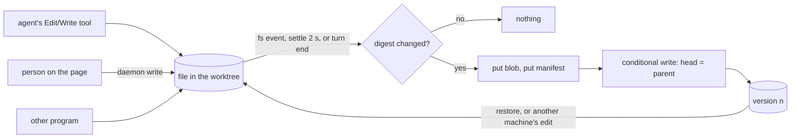

# Artifacts: the model, and how documents move onto it

Spike #5714, under epic #5713. Time-boxed; ends in this spec and a decision in the issue. No product code.

Read: `docs/explanation/direction.md` (the store), `specs/5239-deploy-model/spec.md` (the deploy model's `Artifact`), `specs/022-live-artifacts/spec.md` (live documents), `specs/007-paper-document-view/spec.md` (obsolete since 2026-09-20; the paper surface lives on in 022).

## Answers

| # | Question | Answer |
|---|---|---|
| 1 | OCI-shaped manifests? | **Yes.** Borrow the data model (digest-addressed blobs, descriptors, an image manifest with `artifactType`, annotations, `subject`). **No registry HTTP API** in the store. |
| 2 | Artifact vs the deploy model's `Artifact` (#5239) | **Both, by ref.** One type, two kinds of ref: a ref whose system is `agents` is **stored** (bytes in our store); any other system (`oci`, `testflight`, `github`) is **only referenced**. The scheme `<system>:artifact:<topic>#<id>` is kept. |
| 3 | Documents move onto the store | **One model, two homes.** An *owned* document lives in the store and is checked out as plain files; a *tracked* file (`specs/`, `README.md`, any file git owns) stays in git and the store keeps its captured versions. An agent's ordinary edit becomes a version when the daemon sees the file settle. |
| 4 | Policy vs S3 Object Lock | Maps 1:1 (below). The folder backend enforces in our code, never claims to be tamper-proof, and **never shows "Compliance" without a bucket with Object Lock**. |
| 5 | Children | Eleven, below, with "blocked by" links. |

## 1. OCI-shaped manifests: yes, without the registry

**Why yes.** The epic needs: immutable versions, content addressing, many files in one thing (a document and its SVGs, a package, build outputs), typed things, free labels, and "attached to / built from" links. The OCI image manifest v1.1 has exactly these, and the deploy model's refs already use `sha256:` ids. Tools that exist for it (`oras`, `skopeo`, `crane`, cosign, SBOM tools) can read an export for free. Not adopting it means designing the same six fields and then mapping them to it later.

**Why not the registry API.** The store is a key/object store with conditional writes (`direction.md`); a folder and an S3 bucket both are one. A registry adds an HTTP service to run in a folder-first, local-first product. A registry can still be a third backend later (an artifact that is also pushed to ghcr.io).

### The shapes

A **blob** is bytes at `sha256:<hex>`. A **version** is an OCI image manifest, itself stored as a blob; its digest is the version's id (immutable).

```json
{
  "schemaVersion": 2,
  "mediaType": "application/vnd.oci.image.manifest.v1+json",
  "artifactType": "application/vnd.agentloops.document.v1",
  "config": { "mediaType": "application/vnd.oci.empty.v1+json", "digest": "sha256:44136f…", "size": 2, "data": "e30=" },
  "layers": [
    { "mediaType": "text/markdown", "digest": "sha256:…", "size": 4096,
      "annotations": { "org.opencontainers.image.title": "plan.md" } },
    { "mediaType": "image/svg+xml", "digest": "sha256:…", "size": 812,
      "annotations": { "org.opencontainers.image.title": "diagram.svg" } }
  ],
  "annotations": {
    "org.opencontainers.image.created": "2026-11-17T10:00:00Z",
    "dev.agentloops.parent": "sha256:<previous manifest>",
    "dev.agentloops.author": "session:abc123",
    "dev.agentloops.session": "abc123",
    "dev.agentloops.capture": "settled"
  }
}
```

Choices that are not obvious:

- **`artifactType` is our kind.** `document`, `image`, `binary`, `package`, `build`, `archive`, `other` (the epic's list) under `application/vnd.agentloops.<kind>.v1`. The file's own type is the layer's `mediaType`, which the viewers (layer 4) key on.
- **Many layers is one artifact.** A document with its pictures is one artifact (022 story 4 already puts the SVG "beside" the document). A single file is the one-layer case.
- **The version chain is `dev.agentloops.parent`, not `subject`.** In OCI, `subject` means "this manifest is *about* that one" and the referrers API lists the referrers of a subject. Using it for "previous version" would make each version a referrer of the last. `subject` is kept for what it means: a signature, an SBOM, an in-toto provenance statement, a test report, a "built from" link, attached to a version. That is the referrers pattern the epic wants for lineage, and it leaves room for cosign.
- **Labels are annotations** (`dev.agentloops.label.<key>`). Provenance (session, work item, change) is annotations at first; an in-toto statement as a referrer later, as the epic says, not a schema of our own.
- **A name is not in the manifest.** The artifact record holds `name`, `kind`, labels, `head` (the current version's digest) and the policy. `head` is the only mutable thing besides the policy: it moves by a conditional write whose condition is the digest the writer saw (as `records.go` and `locks.go` already do). A write that loses the race makes a **second head**, never a silent overwrite (§3, conflicts).
- **Delete is a version too:** a tombstone manifest (`artifactType` `…tombstone.v1`, no layers, `parent` set), like S3's delete marker. Blobs go only by garbage collection after no live version and no policy holds them.

### The store layout (folder backend; the bucket uses the same keys)

```text
<prefix>/v1/artifacts/blobs/sha256/<hex>          bytes, manifests too (OCI image layout's blobs/)
<prefix>/v1/artifacts/by-id/<id>/artifact.json    name, kind, labels, policy, head, heads (when diverged)
<prefix>/v1/artifacts/by-id/<id>/log/<n>.json     one line per version: n, digest, time, author (append-only, conditional create)
```

The `blobs/sha256/` directory is OCI's image layout, so an export is a copy of the reachable blobs plus an `index.json`. **Plain files, no SQLite** (`local-first`): a folder a person can read. The store belongs to the organisation's prefix (`direction.md`, "Isolation"); the one-person Mac's control plane is a folder.

### Library fit (AGENTS.md, "Libraries before our own code")

Checked 2026-11-17.

| Library | Licence | Latest release / last push | Use | Verdict |
|---|---|---|---|---|
| `opencontainers/image-spec` `specs-go/v1` | Apache-2.0 | v1.1.1 (2025-03-03) / 2026-10-22 | Descriptor and Manifest structs | **Use**, types only. Its last release is older than 12 months, but it is the standard's own package and is pushed this month; the packages we need are plain structs with no dependencies. State this in the PR that adds it. |
| `sha256` | Go standard library | | digests | **Use** the standard library. `opencontainers/go-digest` (v1.0.0, 2020) adds nothing we need: do not add it. |
| `oras-project/oras-go` v3 | Apache-2.0 | v3.0.0 (2026-11-01) / 2026-11-16 | OCI layout store, a registry client, referrers | **Not now.** It fits for a later registry backend or for reading an export. The folder store is smaller than its content store. |
| `aws/aws-sdk-go-v2` | Apache-2.0 | weekly / 2026-11-16 | S3 backend: put, get, `If-None-Match` and `If-Match` writes, Object Lock | **Use** for the bucket backend (the service's official SDK comes first in the rule). Test on a scratch MinIO. |
| `minio/minio-go` v7 | Apache-2.0 | v7.4.1 (2026-10-12) / 2026-11-12 | the same, a community library | **Not chosen**: the official SDK is preferred and also covers non-MinIO buckets. |
| `blevesearch/bleve` v2 | Apache-2.0 | v2.6.1 (2026-08-24) / 2026-11-13 | document full-text index | **Use** in the "Documents on artifacts" story, for the derived index. |

Each of the above is pinned in `go.sum`, which Dependabot watches. The tasks that add one say purpose, licence and size in the PR.

## 2. Artifact vs the deploy model's `Artifact`

The deploy model defines `Artifact` as "one immutable thing that a build made or that a deploy uses" and keeps only `kind` and an id (a digest or a version). It does not hold bytes. That stays true for most of its refs: a TestFlight build, a ghcr.io image digest and a commit are not ours to store.

**Decision: the same type, both modes, told by the ref's system.**

| Ref | Mode | Bytes |
|---|---|---|
| `agents:artifact:<topic>#<id>` | stored | in our store |
| `oci:artifact:ghcr.io/alexec/agents-control#sha256:…`, `testflight:artifact:…#812`, `github:artifact:alexec/agents#645acc7` | referenced | elsewhere; we keep the ref only |

- **`<topic>`** for a stored artifact is its project (the record that folders join), so refs read `agents:artifact:agent-loops#plan-5713`; with no project it is the organisation.
- **`<id>`** is the artifact's id, a short name, **or** a version's `sha256:<manifest digest>`. The first is a name that points at the head and **moves**; the second is **immutable**. A deploy model `Version` holds the digest form (the epic's "a release holds artifacts"): resolving a name to a digest when attaching it is the moment that makes the release immutable. A chat or work item can hold either: the name for "the latest plan", the digest for "this one".
- **Adopting** a referenced artifact (a build step pushes the bytes it made: a binary, an `.ipa`, a log) makes a stored one that carries `dev.agentloops.source` = the original ref. The deploy model's `built-from` and lineage links are `subject` referrers (§1) or lineage edges and are unchanged.
- **The deploy model changes only in one place:** its `Artifact` doc says "the ref of a stored artifact, if the bytes are ours". That is the task "Deploy model: `Artifact` points at the store" (child 10). `lineage` keeps its `artifact` node kind.
- **Name:** "Artifact" is the broad thing and "Document" the text kind (epic, Decided). The deploy model's "artifact" and ours are the same word for the same thing on purpose.

## 3. How documents move onto the store

### Today (022)

A live artifact is a Markdown file in the project folder. The agent edits it with its ordinary tools; the app watches the folder and redraws; the person edits the rendered page and the file on disk gets the text. Git versions it, if the repo tracks it. New agent tools exist only for attention (open this, follow me). 022 chose this on purpose: **the agent is given nothing new to write a document.** That is the constraint this spec keeps. The paper view (007) was retired before it was built; 022 carries the paper surface.

### The rule: the worktree file is the working copy; the store holds the versions

Like a git checkout: the file is what everything reads and writes; the store is what remembers. No tool, agent or editor learns about the store to edit a document.



### Two homes (the decision)

| | **Owned** document | **Tracked** file |
|---|---|---|
| Examples | an agent's plan, notes, report, research, a spec draft that is not yet a file in the repo | `specs/…`, `README.md`, `docs/…`, anything a branch and a PR review |
| Truth | the store (the head version) | git, on the file's branch |
| On disk | `<folder>/.agents/artifacts/<name>/…`, plain files, added to `.git/info/exclude` so no `.gitignore` change is committed | where it is in the repo |
| The store's version means | the head | a snapshot captured from this worktree and branch |
| Head | one for the artifact | one for each (folder, branch): `heads` in `artifact.json` |
| Another machine | gets the head, written as a new file | git moves it, as now |

**Why two homes and not "everything in the store".** Alex's decision (2026-11-15) is that documents move onto the store, one model. A *model* it is: both kinds are artifacts, versioned, searchable, viewable, with refs, policy and lineage. But a spec under `specs/` is source: a PR reviews it, `git blame` explains it, a branch merges it, and **every lane here edits them in its own worktree on its own branch**. Putting its truth in the store would drop review and merge, or have us rebuild both. So the store captures it and git stays the file's home; an owned document is the new thing that git was never right for (it has no branch, and it dirties a worktree).

A tracked file becomes owned when a person says so (a "Move to artifacts" action: git rm, the file reappears in `.agents/artifacts/`). Never done by itself. **Alex can overrule:** "everything owned" would change the capture task's binding to one mode and drop the `heads` map; the rest of this spec holds.

### An agent's ordinary file edit becomes a version

The **binding** says which paths are an artifact: a record in the artifact (`source: {folder, path, mode}`) that the daemon reads, and a line in `.agents/artifacts.json` for a tracked file in the repo (so a branch carries it). The daemon already watches the folder for 022 and already sees every agent tool call that names a path. Capture:

1. **Fs event on a bound path** (one watch for all, debounced). The file is **settled** when 2 s pass with no event, or at once at the end of an agent turn, a tool call that wrote the path, a git commit or checkout, a session's end, and a worktree's removal. A settled file is hashed.
2. **Same digest as the head: nothing happens** (a touch, a formatter that changes nothing, a restore). **Different: a version.** The blob is put (it may already exist: dedup), then the manifest with `dev.agentloops.parent` = the head the daemon last saw, then `head` moves by a conditional write.
3. **Capture kind** (`dev.agentloops.capture`): `settled` (2 s), `checkpoint` (turn end, commit, explicit), `manual`. A policy may thin `settled` versions older than N days and keep checkpoints, if retention allows. This keeps a person who types for an hour from leaving 1,800 versions to browse. The version list shows checkpoints first.
4. **Author.** An edit through the page's write goes through the daemon, so it is `person:<id>`. An edit the daemon saw a runtime tool call make is `session:<id>`, exact (the call names the path). Any other fs change in the folder is `unknown` and says so. The author is **recorded, not inferred**; the app must not guess.
5. **A write the agent never makes in the middle:** the daemon writes a checkout by a temporary file and a rename, so a tool never reads half a document; this is also what 022 needs for the page.
6. **Offline and the machine's own spool.** The store is the control plane's. A machine that cannot reach it keeps captures in an outbox in its own data folder (a blob and a line each) and flushes in order; the head condition then decides if it diverged. A capture is never dropped for lack of a network. (A one-person Mac whose control plane is itself has no outbox in practice.)

### Reading and the other way: store to file

- **Restore** version *v*: the daemon writes *v* into the working file. That is then an ordinary edit and **a new version** whose `parent` is the head: history is never rewound.
- **Another machine or session changes the head** (the person typed in the web page; another agent): the daemon writes the new head into the checkout, if the file there has no unsettled change; otherwise it is a conflict (next).
- **Attach to a session:** a session that is given an owned document finds it as a file at a path the brief names, and uses its editing tools. The Brief gets one gated line (memory "Brief, not AGENTS.md, for app tools"); the app tool for *publishing* a non-file thing (a build output, an image) is the story "Agents publish and read artifacts", not needed for documents.
- **Git:** the owned document is excluded from git; the tracked file's version annotates `org.opencontainers.image.revision` with the HEAD sha when the file is clean in it, and `…ref.name` with the branch. A person on the web page can read a tracked file's captured versions with no checkout.

### Conflicts: nothing the person typed disappears

Two ways to diverge: (a) a writer's `parent` is not the head (another machine moved it while this one was offline or racing), (b) the daemon has an unsettled local change when the head moves under it. In both, **the store never overwrites**: it records a second head (`heads: [a, b]`), both are versions, and the viewer shows "Two versions: yours and the agent's". Resolution is a new version with two `parent` annotations (a space-separated list), made by the person (take one, or edit the file). This is 022's collision rule moved to the store: set aside, never lost. **No automatic text merge in the first version** (a later story can try a 3-way merge for text); an agent writing at the same moment as a person in the same passage is the case 022 has already handled on the page.

### What stays as is (022, 007)

The watcher, the follow-the-agent view, the paper surface, the typed-edit on the page and the attention tools. They read and write the **file** and are not changed by the store. What changes: the page's "document" is an artifact with a version list, the file is its checkout, and a restore or another machine's edit reaches the page the way an agent's does (a file change). The old Artifacts pane was removed in #3506: the viewer story brings back the *name*, not that pane's code.

## 4. Policy vocabulary and what each backend can honestly enforce

Policy is on the artifact, or on a project (inherited by each of its artifacts; the stricter wins). It applies to **versions**: a version has a `retain-until` and a `hold` flag.

| Our word | Meaning | S3 Object Lock | Folder backend |
|---|---|---|---|
| **mutability: `new-version-only`** (default) | the head moves by a new version; an old one is never changed | S3 versioning; objects are never overwritten | Content addressing makes bytes immutable by construction: a blob's path is its digest and a put to an existing digest is a no-op. A new version is a conditional create of `log/<n>.json`. **Enforced** by the layout, and checked on read (a blob whose bytes do not match its digest is reported). |
| **mutability: `immutable`** | the name cannot move: one version only | a legal hold or retention on the one version; no new versions | The store refuses a second version. **Enforced by Agent Loops.** |
| **retention** (`retain-until`) | the version cannot be deleted or overwritten until the date | Object Lock retention, **governance** mode: a person with `s3:BypassGovernanceRetention` can shorten it | The store refuses `delete` and policy shortening before the date. **Enforced by Agent Loops**, not by the disk. |
| **legal hold** | no delete or change until lifted, no date | Object Lock legal hold (on/off) | The store refuses both until lifted; lifting is a permission (an admin role) and is recorded. **Enforced by Agent Loops.** |
| **compliance** | not even an admin can shorten it | Object Lock retention, **compliance** mode: no one, not the root account, shortens it | **Not possible.** Whoever owns the Unix account can `rm` the folder. |

**What the folder backend honestly is.** The Unix account is the security boundary (`direction.md`); the folder's owner is the admin. So the folder backend gives (1) **immutability by construction** and (2) **policy enforced at the API**: every path an agent, a client or the control plane uses refuses what the policy forbids, and refusal is audited. It does **not** protect against the account's owner or a disk tool. It adds **tamper evidence**: each `log/<n>.json` carries the previous entry's digest, and the head record is signed by the control key; a reader (and the HADR review) can detect a changed or missing version. Detect, not prevent. A person can also set the operating system's user-immutable flag (`chflags uchg`; `chattr +i` on Linux) on retained blobs as a speed bump; it is the owner's to unset and is not offered as protection.

**What the UI says.** The effective enforcement is stored on each version (`enforcement: store | bucket-lock`) and shown in words, never a bare badge:

- folder: *"Kept until 12 Mar 2027. Enforced by Agent Loops; anyone with this folder's account can delete the files."*
- bucket with Object Lock, governance: *"Kept until … (the bucket's governance lock)."*
- bucket with Object Lock, compliance: *"Kept until … No one can shorten it (the bucket's compliance lock)."*

**The folder store accepts a `compliance` request only as `retention` and tells the person so, never "Compliance".** (The epic leaves this as "best-effort; the word is kept for a bucket with Object Lock"; this is the same decision with the UI rule stated.)

**Shared blobs.** Content addressing deduplicates: two artifacts with the same bytes share one blob. The blob's lock is the **latest** `retain-until` of any version that references it (a bucket's lock can be extended, and in compliance mode only extended), and a hold if any reference has one. Garbage collection deletes a blob only when no version references it and no lock is left; it runs with a minimum age so a put in flight is never collected.

**Where the policy is edited:** web only (Admin), per the tier. The Mac window and the Remote **show** it on an artifact (what is kept until when) because viewing is Core.

## 5. Open items for the children (not decided here)

- **Where the daemon's outbox is bounded** (data bound, `HADR`): size cap and what is shown when full. The capture task sets it.
- **A person's typed edit versions** show as `settled` every 2 s of pause; the thinning rule's default age (N days) is a setting, `thin settled versions after 7 days` proposed.
- **Index.** Bleve over the head's text layers, in the daemon or the control plane, derived from the store and rebuildable; not decided here (a story).
- **Signatures** (cosign) as referrers: not in the epic; the shape leaves room.
- **Tier** (Alex, 2026-11-15): viewing artifacts is Core; retention and compliance policy is Web only.
- **Export as an OCI layout** (so `oras`, `skopeo` read it): a possible small task after versions exist; not filed.

## 6. The children, with their "blocked by"

Under #5713, all `feature:artifacts`. Size labels by the rubric at filing.

| # | Kind | Child | Blocked by |
|---|---|---|---|
| 1 | Task | Blob store interface and the folder backend (**#5715**, exists) | none |
| 2 | Task | Artifact records and versions: the manifest, `head` by conditional write, refs, wire methods (put, get, list versions) | 1 |
| 3 | Task | S3-compatible backend (aws-sdk-go-v2; scratch MinIO) | 1 |
| 4 | Task | Capture: a bound file's edit becomes a version; the checkout (owned and tracked homes, settle, author, outbox, restore, conflicts) | 2 |
| 5 | Task | Policy in the folder backend: retention, hold, mutability, tamper evidence | 2 |
| 6 | Task | Policy on the bucket: Object Lock mapping and compliance mode | 3, 5 |
| 7 | Story | Browse and view artifacts: list, versions, viewers (Core: Mac, Remote, web) | 2 |
| 8 | Story | Agents publish and read artifacts: app tool, gated Brief line | 2, 4 |
| 9 | Story | Policy settings (Admin; web only) | 5 |
| 10 | Story | Documents on artifacts: the index, search, versions from saves (022 on the store) | 4, 7 |
| 11 | Task | Deploy model: `Artifact` points at the store; a release holds artifacts | 2, and the deploy model's own tasks (#5239) |
| 12 | Story | Lineage: "built from" and "used by" for an artifact | 2, 11 |

The epic's plan listed the same work. New in this spec: **child 4** (the answer to "how does a file edit become a version"), and the policy task split in two (5, 6), because the folder-first decision means the folder's enforcement can land before the bucket exists.

## Decided

- **OCI image manifest v1.1, no registry API,** because it gives us the six fields we need and a path to every tool; a registry backend stays possible.
- **Same type for the deploy model and the store, told by the ref's system,** because it keeps `<system>:artifact:<topic>#<id>` and needs no second type.
- **Version chain is an annotation, not `subject`,** because `subject` is for attachments and referrers.
- **Two homes (owned and tracked),** because a spec is reviewed and merged in git on a branch and a plan is not.
- **Capture is the daemon watching a settled file,** because agents are given nothing new (022's constraint).
- **The folder backend never shows "Compliance",** because the account's owner can delete the folder.

Alex can overrule any of these; none is costly to reverse before child 2 lands.
